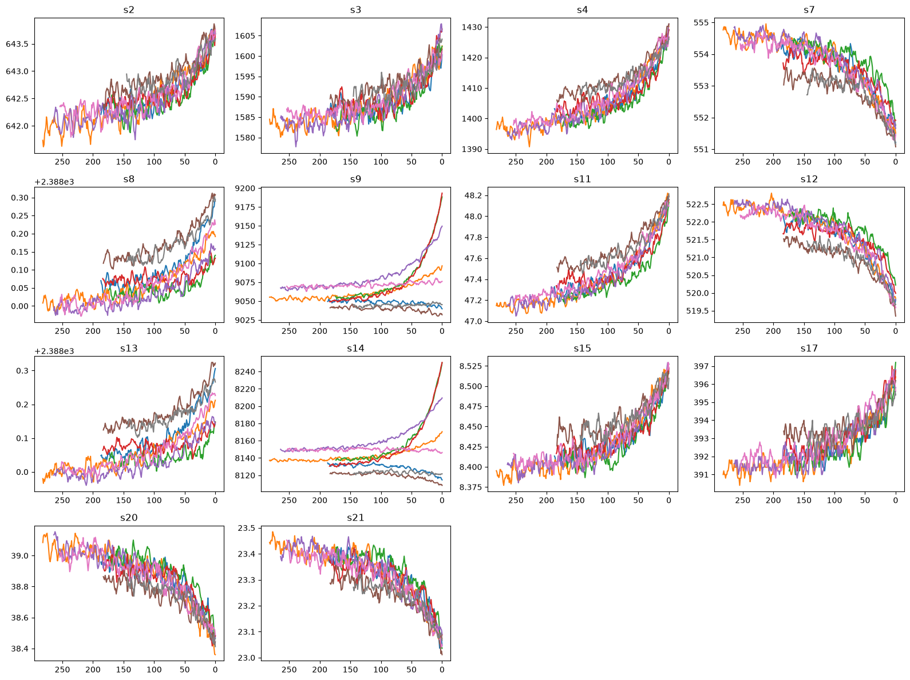
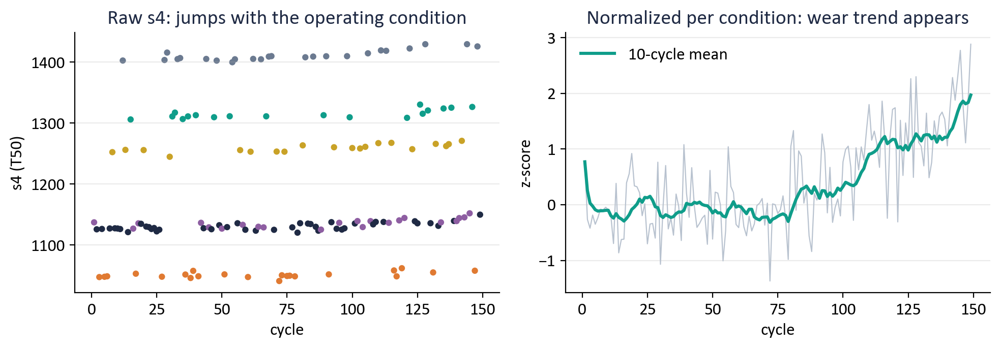
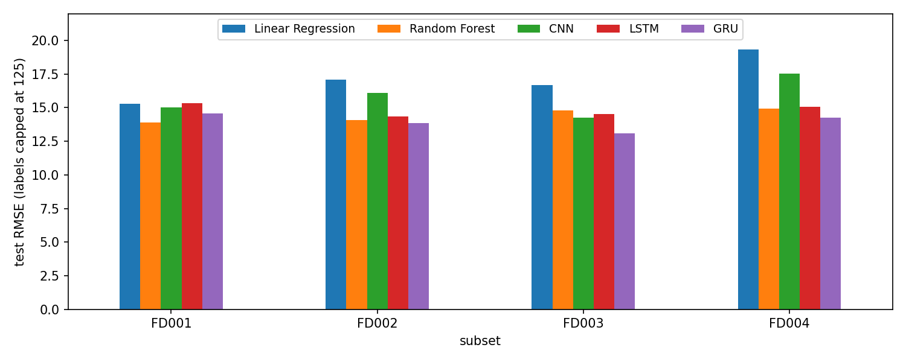
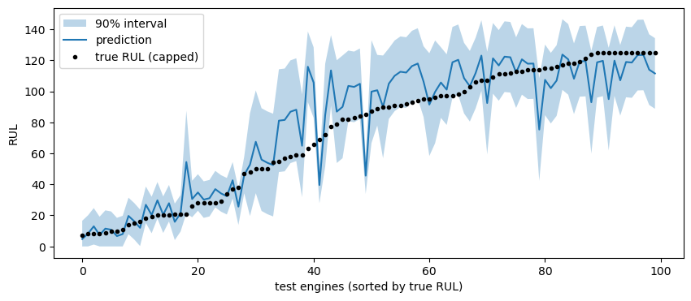
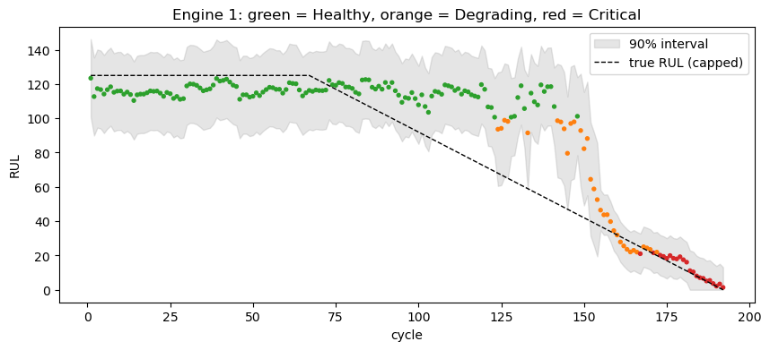
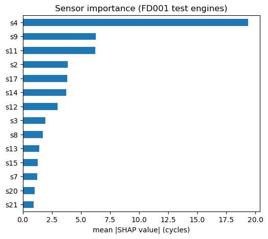
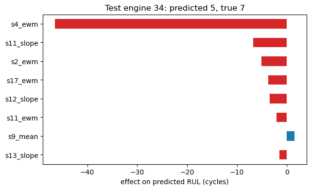

# From Prediction to Decision: Remaining Useful Life Prediction and Predictive Maintenance for Turbofan Engines

**Team:** Rakesh Rayavarapu (142401032) · Rohan Samir Joshi (142401033) · Prabhav Kumar (142401029) · Bala Krishna (142401023)

**Dataset:** NASA C-MAPSS Turbofan Engine Degradation Simulation (FD001–FD004)

---

## Abstract

We predict the Remaining Useful Life (RUL) of turbofan engines from multivariate sensor data and turn the
predictions into maintenance decisions. On the four NASA C-MAPSS subsets we compare two classical models
(Linear Regression, Random Forest) and three deep learning models (1D-CNN, LSTM, GRU). With test labels capped
at 125 cycles, the best models reach a test RMSE of 13.1–14.3 on every subset: Random Forest is best on FD001
(13.90) and the GRU on FD002–FD004 (13.84, 13.07, 14.26). An ablation study shows that capping the RUL target and
normalizing per operating condition are both essential: without either one, the Random Forest's test RMSE rises by
50–180% (capped labels). On top of the point prediction we add (1) 90% prediction
intervals with split conformal prediction, which reach 89–94% coverage on the test engines, (2) SHAP explanations
of each prediction, and (3) a maintenance policy that services an engine when the lower end of its interval drops
below a safety margin. Simulated on held-out engines from their first cycle to failure, this policy had no failures
on any subset and cost 33–42% less than the best fixed-interval maintenance schedule. A Streamlit dashboard
replays an engine cycle by cycle and shows the prediction, its interval, the explanation and the recommendation.

---

## 1. Introduction

Unplanned engine failures are expensive and dangerous. Maintenance is therefore usually done on a fixed schedule,
which is safe but wasteful: every engine is serviced as early as the weakest engine needs it. Predictive maintenance
instead estimates, from sensor data, how many cycles each engine has left (its RUL) and services it based on its
own condition.

Most work on C-MAPSS stops at a single RUL number and reports its RMSE. A single number is not enough to act on:
a maintenance planner also needs to know how sure the model is, why it made the prediction, and when to schedule
the service. Our contributions are:

1. A complete, leakage-free pipeline (condition-wise normalization, capped RUL target, engine-wise splits) evaluated
   on all four C-MAPSS subsets with five models.
2. Calibrated 90% prediction intervals using split conformal prediction.
3. SHAP explanations at the level of individual sensors.
4. A maintenance decision rule built on the intervals, compared against reactive and fixed-interval maintenance.
5. An interactive dashboard that brings these together.

---

## 2. Dataset

C-MAPSS (Saxena et al., 2008) is simulated run-to-failure data from a commercial turbofan engine model. Each row is
one engine at one flight cycle: engine id, cycle number, 3 operational settings (altitude, Mach number, throttle)
and 21 sensors (temperatures, pressures, fan and core speeds, coolant bleeds).

| Subset | Train engines | Test engines | Operating conditions | Fault modes |
|---|---|---|---|---|
| FD001 | 100 | 100 | 1 | 1 (HPC) |
| FD002 | 260 | 259 | 6 | 1 (HPC) |
| FD003 | 100 | 100 | 1 | 2 (HPC, fan) |
| FD004 | 249 | 248 | 6 | 2 (HPC, fan) |

Training engines run until failure, so the RUL is known at every cycle. Test engines stop at a random point before
failure, and the true RUL at that last cycle is provided. (The dataset's readme lists FD004 as 248 train / 249 test
engines; the files contain 249 / 248.)

- **Operating condition:** the flight situation (altitude, Mach number, throttle) during a cycle. FD002 and FD004 mix six conditions.
- **Fault mode:** which component is wearing out. FD003 and FD004 contain engines failing from either
  high-pressure compressor (HPC) or fan degradation.

---

## 3. Related Work

| Paper | Contribution | How we use it |
|---|---|---|
| Saxena et al. (2008) | Introduced C-MAPSS and the NASA scoring function | Sensor names, scoring function |
| Heimes (2008) | RNN for RUL; introduced the piecewise-linear (capped) RUL target | RUL cap |
| Babu et al. (2016) | First CNN for C-MAPSS | Deep learning reference |
| Zheng et al. (2017) | LSTM with per-condition normalization | LSTM model, normalization |
| Li et al. (2018) | 1D-CNN with 30-cycle windows and a cap of 125 | Window length and cap |
| Angelopoulos & Bates (2021) | Tutorial on conformal prediction | Prediction intervals |
| Lundberg & Lee (2017) | SHAP feature attributions | Explanations |

The NASA score as printed in Saxena et al. (Eq. 11) has its two constants swapped relative to the paper's own
text and figure, which both state that late predictions are penalized more. We use the convention followed by
later work: `exp(-d/13) - 1` for early predictions and `exp(d/10) - 1` for late ones.

---

## 4. Exploratory Data Analysis

Full analysis: `notebooks/01_eda.ipynb`. The main findings and the decisions they led to:

1. **No missing values.** No imputation needed.
2. **Lifetimes vary widely** (FD001: 128–362 cycles, median 199), so the cycle number alone cannot predict failure.
3. **Some sensors carry no information.** In FD001, 7 of 21 sensors are constant or take only 2–3 values. The list
   differs per subset (FD003 keeps two sensors that FD001 drops), so it is computed per subset.
4. **Degradation becomes visible late.** Most sensors stay flat until roughly 100–150 cycles before failure and then
   change sharply (Figure 1). This motivates capping the RUL target at 125.
5. **Operating conditions hide wear.** In FD002 the raw value of sensor s4 jumps with the flight condition and has a
   correlation of −0.04 with RUL. After normalizing within each condition, the wear trend appears and the
   correlation becomes −0.66 (Figure 2).
6. **Fault modes change sensor behaviour.** In FD003, sensor s12 rises in 44 engines and falls in 56, depending on
   the fault, so a model cannot assume a fixed direction of change.
7. **Some test engines are short.** 17 test engines in FD002/FD004 have fewer than 30 cycles.


*Figure 1. Sensor trajectories of eight FD001 engines against RUL (failure at 0). Most sensors are flat for a long
time and change sharply near failure.*


*Figure 2. FD002, engine 1, sensor s4. Left: raw values jump between operating conditions. Right: after
normalizing within each condition the degradation trend is visible.*

---

## 5. Method

### 5.1 Preprocessing (`src/features.py`)

| Step | What we do | Why |
|---|---|---|
| RUL target | Training RUL capped at 125 | Sensors show no wear above ~125 cycles of remaining life |
| Operating conditions | KMeans (k = 6) on the 3 settings for FD002/FD004 | The settings form six tight clusters |
| Sensor selection | Keep sensors with more than 3 distinct values inside every condition (14–16 per subset) | Constant sensors carry no wear signal |
| Normalization | Z-score each sensor within its condition, using training statistics only | Removes the condition effect without leaking test data |
| Split | By engine, never by row | Rows of one engine are nearly identical, so a row split would leak |
| Windows (deep models) | Last 30 cycles × sensors; short test engines padded with their first reading | Standard window length (Li et al., 2018) |
| Rolling features (classical models) | Mean, standard deviation, slope and exponential smoothing of each sensor over 30 cycles | Tree and linear models cannot read a sequence |

### 5.2 Models

- **Linear Regression** on the rolling features: shows how much of the signal is linear.
- **Random Forest** (200 trees, `min_samples_leaf=2`) on the rolling features.
- **1D-CNN** (`src/deep_models.py`): two convolution layers (32 and 64 filters, kernel 5) along time, then a dense layer.
- **LSTM / GRU**: two recurrent layers with 64 units; the output at the last cycle goes to a small dense layer.

The deep models are trained with MSE loss and Adam (learning rate 1e-3, batch size 512) on 80% of the training
engines. The other 20% are used for early stopping: training stops when the validation RMSE has not improved for
8 epochs, and the best weights are kept.

### 5.3 Evaluation protocol

Following the benchmark, each test engine is scored once, at its last observed cycle. Because the models are trained
to predict "125" for any healthy engine, we compare against test labels capped at 125 as well. Capping only changes
how predictions are scored; the model never sees test labels. Uncapped results are reported alongside. Metrics:

- **RMSE** in cycles.
- **NASA score**: a sum over engines that penalizes late predictions (predicting failure too late) more than early ones. Lower is better.

### 5.4 Prediction intervals (`src/conformal.py`)

We use split conformal prediction. The training engines are split by engine into 60% for training the Random Forest,
20% for calibration and 20% for evaluating maintenance policies. On the calibration engines we measure the absolute
errors of the model; the half-width *q* of the 90% interval is the 90th percentile of those errors (with the
standard small-sample correction). *q* is computed separately for predicted RUL below 50, 50–100 and above 100, so
that intervals can be narrower near failure. For FD001: *q* = 11.8, 33.1 and 22.8 cycles.

### 5.5 Explanations

SHAP (`shap.TreeExplainer`) splits each Random Forest prediction into contributions from each of the rolling
features: prediction = average prediction + sum of SHAP values. We sum the four features of each sensor to obtain
sensor-level importance.

### 5.6 Maintenance decision (`src/maintenance.py`)

Each engine is classified as **Critical** if the lower end of its interval is below the safety margin, **Degrading**
if its predicted RUL is below 100, and **Healthy** otherwise. We compare three policies on the evaluation engines,
each simulated from its first cycle to failure:

| Policy | Rule |
|---|---|
| Reactive | Run every engine until it fails |
| Fixed interval | Service every engine after *T* cycles; *T* is chosen to minimize cost on the training engines |
| Predictive (ours) | Service an engine as soon as the lower end of its 90% interval drops below 10 cycles |

Planned maintenance costs 1 and a failure costs 10 (relative units). Policies are compared by **cost per 1000
cycles flown**, so servicing too early is also penalized: the engine flies fewer cycles for the same cost.

---

## 6. Results

### 6.1 Prediction accuracy

**Table 1. Test RMSE (labels capped at 125). Best per subset in bold.**

| Model | FD001 | FD002 | FD003 | FD004 |
|---|---|---|---|---|
| Linear Regression | 15.28 | 17.10 | 16.70 | 19.32 |
| Random Forest | **13.90** | 14.06 | 14.79 | 14.92 |
| CNN | 15.00 | 16.08 | 14.24 | 17.53 |
| LSTM | 15.32 | 14.37 | 14.51 | 15.05 |
| GRU | 14.55 | **13.84** | **13.07** | **14.26** |

**Table 2. NASA score (labels capped at 125, lower is better).**

| Model | FD001 | FD002 | FD003 | FD004 |
|---|---|---|---|---|
| Linear Regression | 390 | 1,654 | 543 | 1,872 |
| Random Forest | **331** | 1,036 | 681 | 1,264 |
| CNN | 453 | 1,302 | 490 | 2,142 |
| LSTM | 536 | 1,245 | 633 | 1,224 |
| GRU | 401 | **931** | **387** | **1,031** |


*Figure 3. Test RMSE of the five models on the four subsets.*

Observations:

- Random Forest beats Linear Regression on every subset, so the relation between sensors and RUL is clearly non-linear.
- The GRU is the best model on FD002, FD003 and FD004. Its largest advantage is on FD003 (two fault modes), where it
  beats Random Forest by 1.7 RMSE and has a much lower NASA score (387 vs 681): Random Forest makes more late
  predictions there.
- Random Forest is best on FD001, the simplest subset, where four summary features per sensor are enough.
- The CNN is the weakest deep model, especially on FD004.
- **Uncapped labels.** Without capping the test labels, Random Forest's RMSE is 15.0 / 26.4 / 16.2 / 26.8. The
  large values on FD002/FD004 come from healthy engines: 57 of 259 and 67 of 248 test engines have a true RUL above
  125, which a model trained on capped labels cannot predict. This alone sets an RMSE floor of about 18.3 (FD002)
  and 19.5 (FD004).
- **Literature.** Published FD001 results include about 18.4 RMSE for the CNN of Babu et al. (2016), 16.1 for the
  LSTM of Zheng et al. (2017) and 12.6 for the CNN of Li et al. (2018) **[check these values against the papers]**.
  Our uncapped Random Forest result (15.0) is between them. A direct comparison depends on how each paper treats
  the test labels.

### 6.2 Ablation study

To check that the two main preprocessing steps are needed, we retrained the Random Forest with one step switched off
at a time (`models/ablations.py`). Everything else (features, sensors, model settings) stays the same.

**Table 3. Ablation study, Random Forest test RMSE. "Capped" scores against test labels capped at 125, "uncapped"
against the true test labels.**

| Variant | Metric | FD001 | FD002 | FD003 | FD004 |
|---|---|---|---|---|---|
| Full pipeline | capped | **13.90** | **14.06** | **14.79** | **14.92** |
| | uncapped | **15.00** | **26.35** | **16.20** | **26.82** |
| No RUL cap (train on true RUL) | capped | 28.51 | 25.57 | 34.42 | 41.78 |
| | uncapped | 27.83 | 27.02 | 33.63 | 35.24 |
| No per-condition normalization | capped | – | 21.16 | – | 24.62 |
| | uncapped | – | 32.27 | – | 35.09 |

- **The RUL cap is essential.** Without it the error roughly doubles on FD001 and FD003, *even when scored against
  the true, uncapped labels* (FD001: 15.0 → 27.8). Without the cap the model is trained to predict large RUL values
  for healthy engines whose sensors look identical, which adds noise to the whole model.
- **Per-condition normalization is essential for FD002 and FD004.** With one global normalization the capped RMSE
  rises from 14.06 to 21.16 (FD002) and from 14.92 to 24.62 (FD004), because the operating condition, not the wear,
  then dominates the sensor values (Figure 2).

### 6.3 Prediction intervals

**Table 4. 90% conformal intervals on the test engines (Random Forest trained on 60% of engines).**

| | FD001 | FD002 | FD003 | FD004 |
|---|---|---|---|---|
| Test RMSE | 15.71 | 14.23 | 15.72 | 16.00 |
| Coverage (target 90%) | 90% | 94% | 89% | 93% |
| Average width (cycles) | 43.2 | 52.3 | 44.5 | 53.2 |

The coverage is close to the 90% target on every subset, so the intervals are well calibrated. They are wide on
average, mostly because of healthy engines; close to failure they are much narrower (Figure 4). Coverage holds on
average but not at every moment: in Figure 5 the model keeps predicting "healthy" for too long in mid-life, and the
true RUL drops below the interval for a while, before the prediction catches up near the end.


*Figure 4. FD001 test engines sorted by true RUL, with predictions and 90% intervals.*


*Figure 5. One FD001 evaluation engine from cycle 1 to failure. Colours show the health state (green = Healthy,
orange = Degrading, red = Critical).*

### 6.4 Explanations

Sensor s4 (LPT outlet temperature) is by far the most important sensor for FD001 (mean |SHAP| 19.4 cycles),
followed by s9 (core speed, 6.3) and s11 (HPC static pressure, 6.3). s4 and s11 were also among the strongest
sensors in the EDA. s12 and s7, which were strongly correlated with RUL in the EDA, receive little credit because
they move together with s4 and s11, and the forest mostly uses one sensor from each correlated group. Figure 7
explains a single prediction: test engine 34 is predicted to have 5 cycles left (true: 7), mostly because of its
smoothed s4 value, which lowers the prediction by about 47 cycles.


*Figure 6. Mean absolute SHAP value per sensor (FD001 test engines).*


*Figure 7. The eight features with the largest effect on the prediction for test engine 34.*

### 6.5 Maintenance decision

**Table 5. Cost per 1000 cycles on the evaluation engines (maintenance = 1, failure = 10).**

| | FD001 | FD002 | FD003 | FD004 |
|---|---|---|---|---|
| Evaluation engines | 20 | 52 | 20 | 49 |
| Reactive | 46.09 | 50.59 | 42.89 | 40.00 |
| Fixed interval (*T*) | 7.87 (127) | 9.16 (128) | 6.94 (144) | 7.87 (127) |
| **Predictive (ours)** | **5.13** | **5.67** | **4.62** | **4.55** |
| Failures: fixed / predictive | 0 / 0 | 1 / 0 | 0 / 0 | 0 / 0 |
| **Saving vs fixed** | **35%** | **38%** | **33%** | **42%** |

The best fixed interval is just below the life of the shortest-lived training engine (e.g. 127 cycles on FD001,
where the shortest training engine lasted 128). It is safe but wasteful: on FD001 every engine is serviced at 127
cycles, while the predictive policy lets engines fly 195 cycles on average (true average life: 217) and still has
no failures. Running engines to failure is 8–10 times more expensive than either.

**Table 6. Effect of the safety margin (FD001).**

| Safety margin (cycles) | Failures | Average cycles flown | Cost per 1000 cycles |
|---|---|---|---|
| 0 | 20 | 217 | 46.09 |
| 5 | 0 | 201 | 4.99 |
| 10 | 0 | 195 | 5.13 |
| 20 | 0 | 170 | 5.88 |
| 40 | 0 | 146 | 6.86 |

A margin of 0 never triggers (the lower bound cannot go below 0), so it behaves like running to failure. Any margin
of 5 cycles or more avoids all failures; larger margins are safer but waste engine life.

---

## 7. Dashboard

`app/dashboard.py` is a Streamlit app that brings the results together for one engine at a time:

- Choose a subset and an evaluation engine, then press **Play** to replay it from any cycle to failure (about 20 seconds).
- The current cycle, predicted RUL with its 90% interval, the health state (green / amber / red) and the
  recommendation ("Service within 86 cycles" or "Service now").
- A chart of the prediction and its interval over time, a chart of the top sensors, and a SHAP chart explaining the
  current prediction.
- A safety-margin slider that changes when the engine would be serviced.
- A model-comparison tab with Tables 1 and 5.

---

## 8. Limitations

- **One random seed.** Each deep model was trained once. Re-training with another seed can change the RMSE by about
  1 cycle, so small differences between models (for example LSTM vs CNN on FD001) are not reliable.
- **No hyperparameter tuning.** Layer sizes, learning rate and window length were fixed.
- **Different training sets.** Deep models were trained on 80% of the engines (20% for early stopping), the baselines
  on 100%, and the Phase 6 Random Forest on 60%.
- **Small evaluation sets.** FD001 and FD003 have only 20 evaluation engines, so the exact savings would change with
  a different split.
- **Assumed costs.** The costs of maintenance (1) and failure (10) are assumptions. Because neither the fixed nor the
  predictive policy had failures on most subsets, the result does not depend on the failure cost.
- **Simulated data.** C-MAPSS is simulated. Real engines have more noise, missing data and maintenance events.
- **Intervals are for Random Forest only.** Conformal prediction works with any model, but we did not apply it to the GRU.

---

## 9. Conclusion and Future Work

Careful preprocessing matters as much as the model: capping the RUL target and normalizing per operating condition
are what make the harder subsets learnable. With that in place, a Random Forest on simple rolling features is a
strong baseline (13.9–14.9 RMSE), and a GRU improves on it for the subsets with several operating conditions or
fault modes (down to 13.07 on FD003). Turning predictions into decisions adds the most practical value: calibrated
intervals let us schedule maintenance per engine, which avoided all failures and cost 33–42% less than the best
fixed schedule.

Future work: conformal intervals for the GRU; averaging several seeds; hyperparameter tuning; intervals whose width
adapts per engine (conformalized quantile regression); and testing on the newer N-CMAPSS dataset or real data.

---

## References

1. A. Saxena, K. Goebel, D. Simon, N. Eklund. Damage Propagation Modeling for Aircraft Engine Run-to-Failure Simulation. *PHM 2008*.
2. F. O. Heimes. Recurrent Neural Networks for Remaining Useful Life Estimation. *PHM 2008*.
3. G. S. Babu, P. Zhao, X.-L. Li. Deep Convolutional Neural Network Based Regression Approach for Estimation of Remaining Useful Life. *DASFAA 2016*.
4. S. Zheng, K. Ristovski, A. Farahat, C. Gupta. Long Short-Term Memory Network for Remaining Useful Life Estimation. *IEEE ICPHM 2017*.
5. X. Li, Q. Ding, J.-Q. Sun. Remaining Useful Life Estimation in Prognostics Using Deep Convolution Neural Networks. *Reliability Engineering & System Safety*, 2018.
6. A. N. Angelopoulos, S. Bates. A Gentle Introduction to Conformal Prediction and Distribution-Free Uncertainty Quantification. *arXiv*, 2021.
7. S. M. Lundberg, S.-I. Lee. A Unified Approach to Interpreting Model Predictions. *NeurIPS 2017*.

---

## Appendix: Reproducing the Results

```bash
pip install -r requirements.txt
python -m src.check_data              # verify the dataset
python -m models.compare_baselines    # Table 1-2: Linear Regression, Random Forest (~7 min)
python -m models.train_deep           # Table 1-2: CNN, LSTM, GRU (~30 min on CPU)
python -m models.ablations            # Table 3 (~10 min)
python -m models.run_phase6           # Tables 4-5 (~7 min)
streamlit run app/dashboard.py        # dashboard
```

| Notebook | Content |
|---|---|
| `01_eda.ipynb` | Exploratory data analysis (Section 4) |
| `02_preprocessing.ipynb` | Preprocessing steps (Section 5.1) |
| `03_deep_learning.ipynb` | CNN, LSTM, GRU (Section 6.1) |
| `04_intervals_shap_maintenance.ipynb` | Intervals, SHAP, maintenance (Sections 6.3–6.5) |
